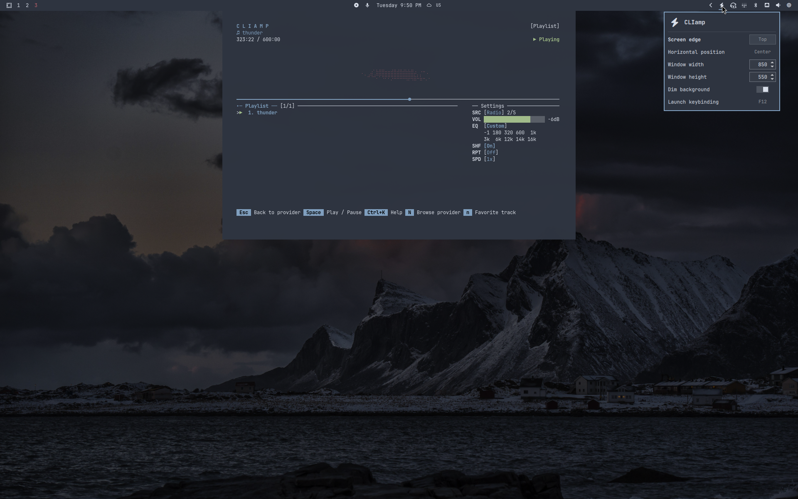

# CLIamp quake

A Quake-style drop-down for CLIamp. Open it from the bar or your music shortcut,
then choose its screen edge, position, and size. Under 1,200 lines of core code,
with measured idle plugin overhead below 4 MiB, excluding CLIamp and its
terminal.

[][demo]

[Watch the demo][demo] which shows: changing position, resizing, and showing or
hiding the player. The key and mouse overlay in the video is a separate tool.

## Use

- **Left-click** the lightning bolt to show or hide CLIamp.
- **Right-click** to choose a screen edge, position and resize the player, or
  toggle background dimming.
- Turn on **Keep open** to leave CLIamp on screen while you work in other
  windows. It then floats above them on every workspace, and Alt+Tab or a click
  moves focus between it and your other windows. Your shortcut shows or hides
  it, whichever window has focus.
- Size arrows resize immediately in 50 px steps. Typed values apply on **Enter**
  or when you click elsewhere in the panel.
- Select **Launch keybinding** to edit your shortcut in Omarchy's editor.

The default size is **1200 x 600**, centered on the top edge. Larger sizes fit
within the available screen space. Regular CLIamp windows are unaffected.
Background dimming applies only to the drop-down, not while **Keep open** is on.

Your existing CLIamp music shortcut works with the drop-down. Omarchy's default
is **Super+Shift+Alt+M**; the demo uses a custom **F12** binding.

## Install

Requires Omarchy Quattro, Hyprland **0.56.2 or newer**, and CLIamp. The helpers
use Bash, jq, Lua, and hyprctl, available in a standard Omarchy installation.

```bash
omarchy plugin add https://github.com/omarchy-QOL/omarchy-cliamp-control.git --enable
```

No extra setup is needed. CLIamp opens exactly as it would in a terminal, with
your own library, playlists, and settings.

## Update or remove

```bash
omarchy plugin update io.github.ilyazar.cliamp
```

```bash
omarchy plugin remove io.github.ilyazar.cliamp
```

Removal closes the plugin's drop-down and restores your original music
shortcuts. Your CLIamp configuration stays unchanged.

## License

MIT.

[Development and checks](docs/development.md).

[demo]:
  https://omarchy-qol.github.io/omarchy-cliamp-control/assets/published/cliamp-quake.mp4
